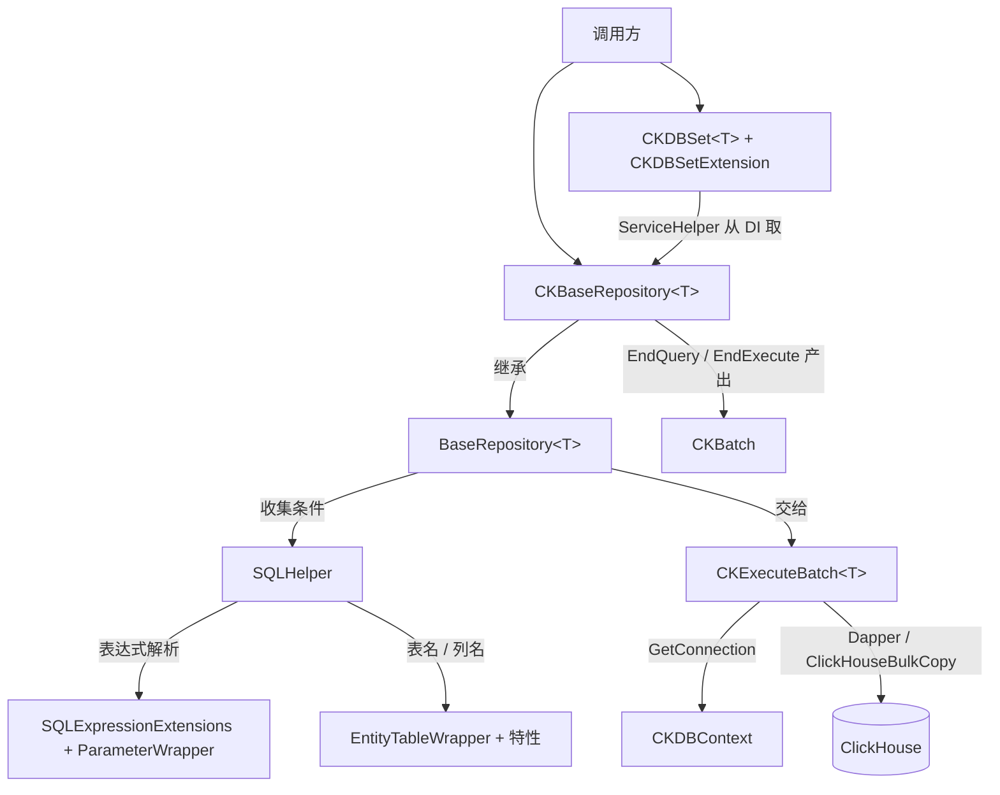

# CKSimpleORM 架构

面向 ClickHouse 的精简 ORM，只处理单表增删改查。多表关联直接写 SQL。

## 分层



| 层 | 类型 | 职责 |
| --- | --- | --- |
| 入口 | `CKDBSet<T>`、`CKDBSetExtension` | 静态风格入口，每次调用从 DI 取一个仓储 |
| 仓储 | `BaseRepository<T>` | 链式 API；把条件交给 `SQLHelper`，把批次交给执行器 |
| 仓储 | `CKBaseRepository<T>` | ClickHouse 方言：`EndQuery` 拼查询 SQL，`EndExecute` 准备写入数据 |
| 条件收集 | `SQLHelper`、`ParameterWrapper` | 按 Select / Where / OrderBy / Update 分组收集列映射和 Dapper 参数 |
| 元数据 | `EntityTableWrapper`、`EntityMapTable` | 反射特性得到表名、列名、主键，按类型缓存 |
| 批次 | `IBatch` / `CKBatch` | `Sql` + `DynamicParameters`，或批量写入的 `Value`（`List<T>`） |
| 执行 | `IExecuteBatch<T>` / `CKExecuteBatch<T>` | 用 Dapper 查询和执行，用 `ClickHouseBulkCopy` 批量写入 |
| 连接 | `IDbContext` / `CKDBContext` | 连接串、日志、并行度；`ViewType = true` 时不给连接 |

## 实体元数据

| 特性 | 作用 |
| --- | --- |
| `[TabelName("t")]` | 类对应的表名 |
| `[ColumnName("c", "String")]` | 属性对应的列名和 ClickHouse 类型；不标则用属性名 |
| `[PK]` | 主键，`QueryByPK`、按主键更新/删除都靠它 |
| `[Increment]` | 自增列 |
| `[Ignore]` | 不参与 SQL |

首次用到某个类型时反射一次，结果缓存在 `EntityTableWrapper` 的静态字典里。

## 查询流程

1. `Where` / `Select` / `OrderBy` / `Top` 把表达式交给 `SQLHelper`。
2. `SQLExpressionExtensions` 遍历表达式树：属性变成列映射，常量和外部变量变成 `@随机名` 参数，`==`、`&&`、`Contains` 等变成运算符。
3. 调用 `Query*` 时，`CKBaseRepository.EndQuery` 把收集结果拼成：

   ```sql
   SELECT [TOP n] 列... FROM 表 FINAL
   WHERE 表.sign = 1 AND ( 条件 )
   ORDER BY ...
   ```

4. 批次交给 `CKExecuteBatch` 用 Dapper 执行。
5. `EndQuery` 结束后清空 `SQLHelper`，下一次链式调用从头开始。

直接传 SQL 的 `Query(sql, parameters)` 和 `QueryByPage` 不经过表达式解析。分页在末尾追加 `LIMIT offset, count`；带总数的版本再执行一次 `SELECT COUNT(1) FROM (sql)`。

## 写入流程

ClickHouse 表约定带 `version`、`sign`、`_insert_time` 三列，增删改都是追加新行：

| 操作 | 做法 |
| --- | --- |
| 插入 | 写入 `sign = 1` 的行 |
| 更新 | 写入完整的新行，由 `FINAL` 按主键取最新版本 |
| 删除 | 写入 `sign = 0` 的行，查询固定过滤 `sign = 1` |

`EndExecute` 按 `SQLHelper.Table` 上的操作类型分派：

- 插入：直接把列表放进批次 `Value`。
- 更新：
  - 传了列表且用 `UpdateColumns` 选了列：按主键逐条查出库里的数据，只覆盖选中的列，再写回。
  - 传了列表但没选列：整行写回。
  - 没传列表：先按 `Where` 查出数据，用 `UpdateColumnsWithValue` 的值覆盖，再写回。
- 删除：传了列表就直接用；否则按 `Where` 查出数据再写删除行。

之后 `CKExecuteBatch` 的 `BulkInsert` / `BulkUpdate` / `BulkDelete` 把 `Value` 转成行，补上 `version`（当前毫秒）、`sign`、`_insert_time`，再用 `ClickHouseBulkCopy` 写入。主键为空或为默认值会抛错。更新本质上就是插入。

`Where` 后再写入，意味着先查库再写；数据量大时要注意。

## 只打印 SQL

`CKDBContext.ViewType = true` 时 `GetConnection()` 返回 null，`CKExecuteBatch` 不访问数据库：

- 查询和执行：打印 SQL，查询返回空集合，执行返回 0。
- 批量写入：打印 `INSERT` / `DELETE`、表名和列名。

用于在没有 ClickHouse 的环境里检查生成的 SQL。

## 依赖注入

`CKDBSetExtension` 通过 `ServiceHelper.GetService<CKBaseRepository<T>>()` 取仓储，需要在启动时注册 `CKDBContext`、`CKExecuteBatch<T>`、`CKBaseRepository<T>`，并设置：

```csharp
ServiceHelper.Instance = app.Services;
```

也可以像测试项目那样直接 `new`：

```csharp
var context = new CKDBContext(4, logger, connectionString, "app") { ViewType = true };
var repo = new AdgroupCKRepository(new CKExecuteBatch<AdgroupModel>(context));
```

## 已知问题

- 仓储内部持有一个 `SQLHelper`，有状态、非线程安全。每次请求用一个新仓储，不要注册成单例。
- 单条 `Insert(T)`、`Update()` / `Update(T)`、`Delete()` / `Delete(T)` 在基类里走 `Execute`（执行 `batch.Sql`），但 `CKBaseRepository.EndExecute` 只产出 `Value`、不产出 SQL，所以这几个方法目前不能正确写入。列表版本（`InsertList`、`UpdateList`、`Delete(List<T>)`）走批量写入，是可用的。单条写入要么在基类里改走 `Bulk*`，要么在 `EndExecute` 里生成 SQL。
- `Insert(T)` 用 `AddDynamicParams` 存参数，而 `InsertPreExecute` 只读 `ListParams`，单条插入拿不到数据。
- `BulkDelete` 出错时日志写的是「批量插入失败」，并用 `throw ex` 丢失原始堆栈。
- `ExecuteReader(IBatch, int)` 未实现。
